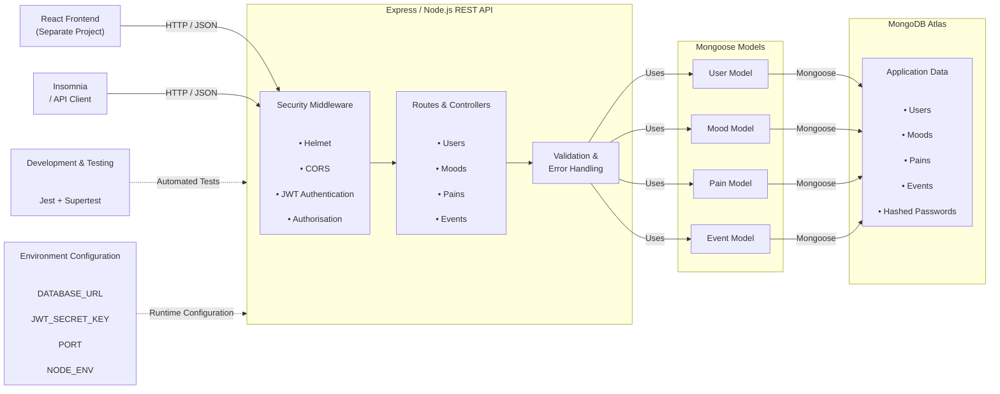
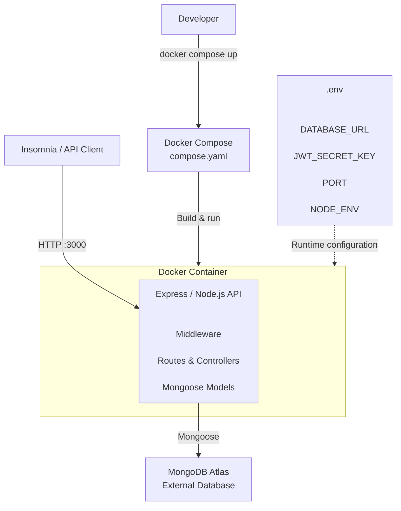
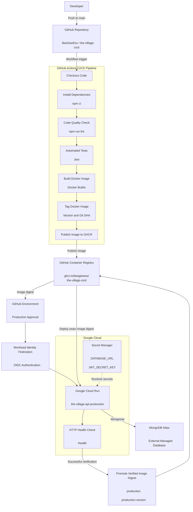
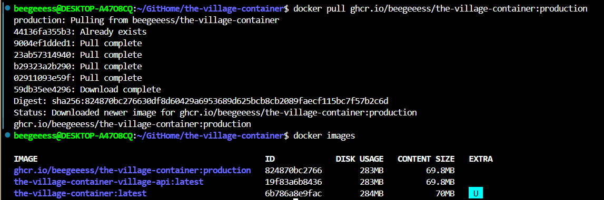
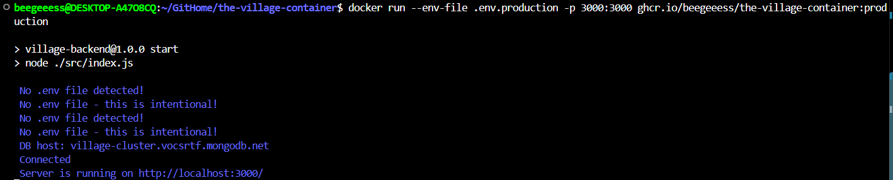
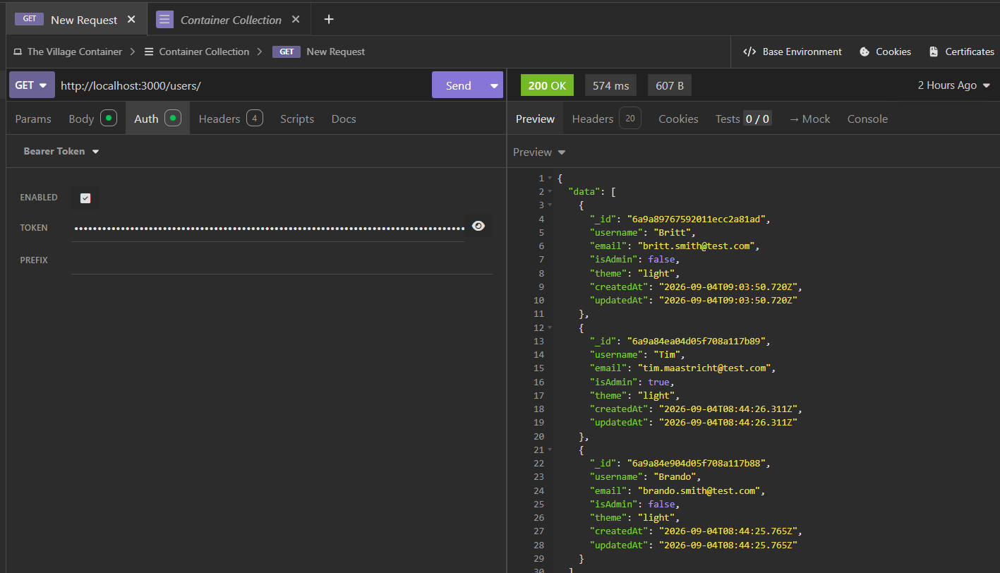

# The Village Wellness App – Backend CI/CD

<picture>
  <source media="(prefers-color-scheme: dark)" srcset="./images/banner-dark.png">
  <source media="(prefers-color-scheme: light)" srcset="images/banner-light.png">
  
</picture>

## Navigation

- [Overview of Project](#overview-of-project)
- [The Village Wellness App](#the-village-wellness-app)
- [Application Architecture](#application-architecture)
- [Containerised Architecture](#containerised-architecture)
- [CI/CD Architecture](#cicd-architecture)
- [Project Features](#project-features)
- [Tech Stack](#tech-stack)
- [Packages](#packages)
- [System Requirements](#system-requirements)
- [Project Structure](#project-structure)
- [Database Structure](#database-structure)
- [Authentication](#authentication)
- [API Endpoints](#api-endpoints)
- [API Request Handling](#api-request-handling)
- [Security](#security)
- [Error Handling](#error-handling)
- [Installation](#installation)
- [Environment Variables](#environment-variables)
- [Running the Server](#running-the-server)
- [Docker Containerisation](#docker-containerisation)
- [Docker Image Tags](#docker-image-tags)
- [CI/CD](#cicd)
- [Container Registry](#container-registry)
- [Scripts](#scripts)
- [Testing](#testing)
- [Deployment](#deployment)
- [JavaScript Style Guide](#javascript-style-guide)
- [License](#license)
- [References](#references)
- [Authors](#authors)

## Overview of Project

This repository contains the containerised Express.js/Node.js backend API for The Village Wellness App. The API provides CRUD operations for users, moods, pains and events, using MongoDB Atlas for persistent data storage and JWT authentication with role-based authorisation.

This project extends the original MERN stack application through Docker containerisation and an automated CI/CD workflow implemented using GitHub Actions.

The deployment workflow integrates automated code validation, testing, Docker image building, container publishing and cloud deployment. Validated images are published to GitHub Container Registry (GHCR) and deployed to Google Cloud Run.

The implementation includes:

- Automated pull request validation using ESLint and Jest.
- Docker image builds using Docker Buildx.
- Versioned container publishing to GHCR.
- Google Cloud authentication using Workload Identity Federation.
- Automated deployment to Google Cloud Run.
- Runtime secret management through Google Cloud Secret Manager.
- Post-deployment health verification.
- Production image promotion using immutable image digests.
- Build and deployment artefacts for traceability.

The frontend and backend remain independently maintained projects, with their own repositories and deployment workflows.

Visit the [project organisation](https://github.com/The-Village-Wellness-App) for more information.

## The Village Wellness App

The Village Wellness App is a web-based health and wellbeing tracking application designed to help users monitor changes in their mood and physical pain over time. The application allows users to record structured entries using rating scales, select predefined labels that describe their emotional or physical state, and optionally add contextual notes.

These entries are then visualised through time-based graphs, enabling users to identify patterns or trends in their wellbeing.

The application also allows users to add event markers to their timeline, such as starting a new medication, beginning therapy, or experiencing a significant life event. These markers provide additional context that may help users understand potential factors influencing their mood or pain levels. By combining structured tracking with visualisation tools, The Village Wellness App aims to support self-reflection and provide users with useful insights that may assist discussions with healthcare professionals.

## Application Architecture

The following diagram represents the existing architecture of The Village Wellness App backend before containerisation.



**Figure 1: Existing Application Architecture**

## Containerised Architecture

The following diagram represents the architecture of The Village Wellness App backend after the Express.js application has been containerised using Docker for development. Docker Compose manages the development container, while MongoDB Atlas remains an external managed database.



**Figure 2: Containerised Development Architecture**

## CI/CD Architecture

The following diagram represents the continuous integration and continuous delivery (CI/CD) architecture used to automatically validate, build, tag, publish and deploy the containerised backend application.

GitHub Actions performs code-quality checks and automated testing before building the Docker image.

The resulting image is published to GitHub Container Registry. The deployment workflow then uses Google Cloud Workload Identity Federation to authenticate with Google Cloud and deploy the image to Cloud Run.

Runtime environment variables and secrets are supplied separately and are not stored in the Docker image.



**Figure 3: CI/CD Architecture**

## Project Features

- Full CRUD operations for users, moods, pains and events.
- JWT-based authentication with 7-day token expiry.
- Role-based authorisation (admin and regular user roles).
- Date-range filtering for mood and pain entries.
- Secure password hashing with scrypt and salt.
- Comprehensive test coverage across router test suites.
- Input validation at model and route levels.
- Consistent error handling with appropriate HTTP status codes.
- Helmet security middleware.
- CORS configuration.
- Automated Jest/Supertest testing.
- Docker containerisation.
- Automated Docker image builds using GitHub Actions.
- Versioned Docker image tags.
- GitHub Container Registry image publishing.

### CI/CD and Deployment Features

- GitHub Actions automated workflows.
- Pull request validation before merging into `main`.
- ESLint code-quality enforcement.
- Automated Jest testing.
- Persistent workflow logs and test-result artefacts.
- Docker image building using Docker Buildx.
- Automated publishing to GitHub Container Registry.
- Application version and Git SHA image identification.
- Google Cloud authentication using Workload Identity Federation (OIDC).
- Reusable Google Cloud Run deployment workflow.
- Secure runtime configuration using Secret Manager.
- Automated Cloud Run health checks.
- Production image promotion following successful deployment verification.
- Deployment metadata and artefact retention.

## Tech Stack

### Chosen Technologies

| Technology | Purpose |
| --- | --- |
| MongoDB Atlas | Stores the application's data |
| Express.js 5.2.1 | Handles API routing and middleware |
| Node.js 26 | Runs the backend server environment |
| Mongoose 9.3.0 | MongoDB object modelling and database communication |
| JWT | Handles authentication |
| Helmet | Provides HTTP security headers |
| CORS | Manages cross-origin browser access control |
| Jest | Runs automated tests |
| Supertest | Performs HTTP/API testing |
| Docker | Provides application containerisation |
| Docker Buildx | Builds and publishes container images |
| GitHub Actions | Automates validation, publishing and deployment |
| GitHub Container Registry | Stores versioned Docker images |
| Google Cloud Run | Hosts the containerised backend API |
| Google Cloud IAM | Manages deployment and runtime permissions |
| Workload Identity Federation | Provides secure GitHub-to-Google authentication |
| Google Cloud Secret Manager | Stores sensitive runtime configuration |
| GitHub Actions Artifacts | Retains build, test and deployment evidence |
| HTTP Health Checks | Verifies successful application deployment |

### Industry Relevance

The MERN stack is widely used in modern full-stack web development due to its scalability, security, performance and ability to use JavaScript across both frontend and backend development[\*](#references).

The technologies used in the MERN stack are widely adopted across contemporary web development.

See State of JavaScript graphs[\*](#references):

- [React Usage](https://share.devographics.com/share/prerendered?localeId=en-US&surveyId=state_of_js&editionId=js2025&blockId=front_end_frameworks_ratios&params=&sectionId=libraries&subSectionId=front_end_frameworks)
- [Express Usage](https://share.devographics.com/share/prerendered?localeId=en-US&surveyId=state_of_js&editionId=js2025&blockId=back_end_frameworks_ratios&params=&sectionId=libraries&subSectionId=back_end_frameworks)
- [Testing with Jest](https://share.devographics.com/share/prerendered?localeId=en-US&surveyId=state_of_js&editionId=js2025&blockId=testing_ratios&params=&sectionId=libraries&subSectionId=testing)

See Stack Overflow graphs[\*](#references):

- [MongoDB (No-SQL Databases)](https://survey.stackoverflow.co/2025/technology#most-popular-technologies-database-database)
- [Node, React, Express Usage](https://survey.stackoverflow.co/2025/technology#most-popular-technologies-webframe-webframe)
- [JavaScript Usage](https://survey.stackoverflow.co/2025/technology#most-popular-technologies-language-language)

### Comparison to Alternative Technologies

| Chosen Technology | Alternative | Reason Chosen |
| --- | --- | --- |
| MongoDB | PostgreSQL | Flexible document-based data model |
| Express.js | Django | Minimalist, customisable, JavaScript-based |
| React | Angular | Component flexibility, rapid development |
| Node.js | ASP.NET | JavaScript development across the stack |

### Licensing Information

| Technology | License |
| --- | --- |
| MongoDB | Server Side Public License (SSPL) |
| Express.js | MIT License |
| React | MIT License |
| Node.js | MIT License |

*Note: Although MongoDB uses an SSPL licence, it is still appropriate to licence this project under MIT because the application:*

1. Is a public educational project.
2. Uses MongoDB as an external database and connects through Mongoose.
3. Does not redistribute, modify or host MongoDB software.

## Packages

The application uses the following production dependencies:

```json
{
  "cors": "^2.8.6",
  "dotenv": "^17.4.2",
  "express": "^5.2.1",
  "helmet": "^8.1.0",
  "jsonwebtoken": "^9.0.3",
  "mongoose": "^9.3.0",
  "smallog": "^1.0.2"
}
```

Development dependencies include:

```json
{
  "cross-env": "^10.1.0",
  "eslint": "^9.39.4",
  "globals": "^17.6.0",
  "jest": "^30.3.0",
  "supertest": "^7.2.2"
}
```

## System Requirements

- Node.js 26.
- npm (compatible with the installed Node.js version).
- Docker Desktop or Docker Engine.
- Docker Compose.
- MongoDB Atlas account or compatible MongoDB database.
- Git and GitHub account.

For cloud deployment, the application uses Google Cloud Run, Google Cloud IAM and Google Cloud Secret Manager.

## Project Structure

```text
📁 the-village-CICD
    📁 .github
        📁 workflows
            ─ backend-ci.yml
            ─ deploy-cloud-run.yml
    📁 images
    📁 src
        📁 controllers
            ─ EventRouter.js
            ─ MoodRouter.js
            ─ PainRouter.js
            ─ UserRouter.js
        📁 middleware
            ─ UserAuthentication.js
            ─ UserAuthorisation.js
        📁 models
            ─ EventModel.js
            ─ MoodModel.js
            ─ PainModel.js
            ─ UserModel.js
        📁 utils
            📁 _dev
                ─ dbSeed.js
                ─ dbWipe.js
                ─ envSetup.js
            ─ dbConnectionManager.js
            ─ jwtUtils.js
        ─ index.js
        ─ server.js
    📁 tests
        ─ eventRouter.test.js
        ─ moodRouter.test.js
        ─ painRouter.test.js
        ─ server.test.js
        ─ userRouter.test.js
    ─ .dockerignore
    ─ application-architecture.md
    ─ compose.yaml
    ─ Dockerfile
    ─ eslint.config.mjs
    ─ example.env
    ─ jest.config.js
    ─ LICENSE
    ─ package-lock.json
    ─ package.json
    ─ README.md
```

**Note:** The `.env` file is not shown in the project structure because it is intentionally excluded from the GitHub repository. It contains local configuration and secrets. The `example.env` file provides an overview of the environment variables that need to be configured.

## Database Structure

This project uses MongoDB as the database and Mongoose as the connection between the Express application and MongoDB.

MongoDB Atlas is kept external to the Docker container. This allows containers to remain replaceable without affecting persistent application data.

### Collections

#### Users

```json
{
  "_userId": "ObjectId",
  "username": "davejohnson",
  "password": "hashed_password",
  "email": "davo@example.com",
  "isAdmin": true,
  "theme": "light",
  "salt": "a8f3c91d2ef4...",
  "createdAt": "2026-05-24T07:15:22.123Z",
  "updatedAt": "2026-05-24T09:41:10.456Z"
}
```

#### Pain

```json
{
  "_painId": "ObjectId",
  "user": "davejohnson",
  "value": 3,
  "location": "neck",
  "optional_text": "string",
  "occurred_at": "2026-05-24T07:15:22.123Z",
  "createdAt": "2026-05-24T07:15:22.123Z",
  "updatedAt": "2026-05-24T09:41:10.456Z"
}
```

#### Events

```json
{
  "_eventId": "ObjectId",
  "user": "davejohnson",
  "title": "breakup",
  "description": "Broke up with my girlfriend Alysha",
  "category": "life_event",
  "occurred_at": "2026-05-24T07:15:22.123Z",
  "createdAt": "2026-05-24T07:15:22.123Z",
  "updatedAt": "2026-05-24T09:41:10.456Z"
}
```

#### Mood

```json
{
  "_moodId": "ObjectId",
  "user": "davejohnson",
  "value": 5,
  "optional_text": "Nothing much happened today, boring day at work",
  "occurred_at": "2026-05-24T07:15:22.123Z",
  "createdAt": "2026-05-24T07:15:22.123Z",
  "updatedAt": "2026-05-24T09:41:10.456Z"
}
```

## Authentication

Authentication uses JSON Web Tokens (JWT). Clients send tokens in the `Authorization` header as `Bearer <token>`. Tokens are issued on signup/login and validated by `src/utils/jwtUtils.js` with a 7-day expiry. Secrets are read from environment variables.

Admin users are not created through the public signup endpoint. Admin accounts must be added directly in the database seed data or created by inserting a user document with `isAdmin: true` into MongoDB.

Password reset flow: Users can initiate a password reset through
`POST /users/forgot-password` using their email address. The server generates a reset token that expires after one hour and returns it in the JSON response.

Users submit the token and new password to `POST /users/reset-password` to complete the reset.

## API Endpoints

Quick overview:

- **Authorization:** Send `Authorization: Bearer <token>` for protected endpoints (all `/moods`, `/pains`, `/events`, and most `/users/*` except `/signup` and `/login`).
- **Admin-only:** `GET /users` and `GET /users/admin/dashboard` require an admin user. Admins can also find a specific user using `GET /users/:userId`.
- **Params and queries:** Use route parameters (`:userId`, `:moodId`, `:eventId`) and optional query filters, e.g. `?startDate=2026-05-01&endDate=2026-05-31`.
- **Responses:** `201` on create, `200` on success, and `400/401/403/404/500` for errors as appropriate.

**Example (login):**

```bash
curl -X POST http://localhost:3000/users/login \
  -H "Content-Type: application/json" \
  -d '{"email":"user@example.com","password":"password123"}'
```

### User Endpoints

- **GET /users** — Admin only: retrieve all users.
- **GET /users/:userId** — Admin or the user themself: retrieve a user's profile (password/salt omitted).
- **GET /users/admin/dashboard** — Admin only: admin dashboard data.
- **POST /users/signup** — Public: create a new account.
- **POST /users/login** — Public: obtain JWT for login.
- **PATCH /users/:userId** — Authenticated user (self-only): update own profile (username, email, password, theme).
- **DELETE /users/:userId** — Authenticated user (self-only): delete own account.
- **DELETE /users/:userId/admin** — Admin only: delete another user's account (admins may also use with their own ID).
- **POST /users/forgot-password** - Generates a password-reset token for the user's email address. The token expires after one hour and is returned in the JSON response as `resetToken`.
- **POST /users/reset-password** - Resets the user's password using the supplied reset token and new password.

**Note:** The `forgot-password` flow is email/token-based, so users do not need to provide their internal MongoDB `_id`. There is no admin-only reset endpoint implemented by default. Admins who need to reset a user's password must perform the change directly in the database/seed data.

### Mood Endpoints

- **GET /moods** — Retrieve all mood entries.
- **GET /moods/:moodId** — Retrieve a specific mood entry.
- **POST /moods** — Create a mood entry.
- **PATCH /moods/:moodId** — Update a mood entry.
- **DELETE /moods/:moodId** — Delete a mood entry.

### Pain Endpoints

- **GET /pains** — Retrieve all pain entries.
- **GET /pains/:painId** — Retrieve a specific pain entry.
- **POST /pains** — Create a pain entry.
- **PATCH /pains/:painId** — Update a pain entry.
- **DELETE /pains/:painId** — Delete a pain entry.

### Event Endpoints

- **GET /events** — Retrieve all event entries.
- **GET /events/:eventId** — Retrieve a specific event entry.
- **POST /events** — Create an event entry.
- **PATCH /events/:eventId** — Update an event entry.
- **DELETE /events/:eventId** — Delete an event entry.

## API Request Handling

- Requests and responses use JSON bodies.
- Route parameters (`:userId`, `:moodId`, etc.) and query parameters (e.g. `startDate` / `endDate`) are used for resource selection and filtering.
- Authorisation is enforced by middleware that reads `Authorization` headers and attaches the authenticated user to `request.customData.user`.
- Input is validated at the route and model level; Mongoose schemas enforce field constraints.

## Security

- `helmet` is used to set secure HTTP headers.
- CORS is configured to restrict origins; adjust `src/server.js` `handyCorsConfig` for production domains.
- Passwords are salted and hashed using `scrypt` (see `UserModel`).
- Store `JWT_SECRET_KEY` and database credentials in environment variables and run the service behind HTTPS.
- The Docker container runs the application using the non-root `node` user. This reduces the privileges available to the application process inside the container.
- Google Cloud Secret Manager supplies sensitive runtime configuration to the Cloud Run service.
- Workload Identity Federation allows GitHub Actions to authenticate with Google Cloud without storing long-lived service account keys in the repository.

The Cloud Run service is configured to allow unauthenticated invocation at the service level. This makes the API endpoint publicly reachable; protected API operations still rely on the application's JWT authentication and authorisation middleware.

## Error Handling

Routes return appropriate HTTP status codes: `400` for bad requests/validation errors, `401` for authentication failures, `403` for forbidden actions, `404` for not found, and `500` for server errors. Sensitive error details are not exposed to clients.

## Installation

Clone the repository, install dependencies and create the local environment file:

```bash
git clone https://github.com/BeeGeeEss/the-village-CICD.git
cd the-village-CICD
npm ci
npm run setup:env
npm run db:seed
npm run start
```

Use `npm run dev` instead of `npm run start` to run the development server with automatic reloads.

## Environment Variables

To run this project, create an `.env` file in the root directory by running `npm run setup:env`.

```env
PORT=3000
DATABASE_URL=mongodb+srv://
JWT_SECRET_KEY=
NODE_ENV=development
```

The repository's `.gitignore` and `.dockerignore` exclude `.env`.

The included `example.env` file can be used as a template without containing real secrets.

## Running the Server

Run the production server:

```bash
npm run start
```

To enable automatic reloading during development:

```bash
npm run dev
```

## Docker Containerisation

Docker packages the backend application and its dependencies into a reusable container image.

### Development Environment

The Dockerfile uses an official Node.js 26 Alpine Linux base image:

```dockerfile
FROM node:26-alpine
```

Application dependencies are installed using `npm ci`. Development dependencies are excluded from the runtime image:

```dockerfile
RUN npm ci --omit=dev
```

Docker Compose is used to define the development container's runtime configuration. The `compose.yaml` file specifies how the Dockerfile is built, maps the application port, and provides environment variables to the container.

The development container can be built using:

```bash
docker compose build
```

The development container can then be started using:

```bash
docker compose up
```

The Compose configuration loads environment variables from the local `.env` file at runtime. This ensures that sensitive configuration such as the MongoDB connection string and JWT secret are not stored in the GitHub repository or included in the Docker image.

The application is available at:

`http://localhost:3000`

Port 3000 on the host machine is mapped to port 3000 inside the container.

MongoDB is not containerised as part of this project. The application connects to MongoDB Atlas as an external managed database using the `DATABASE_URL` environment variable.

To stop the development container:

```bash
docker compose down
```

### Production Image Testing

The production container image is published to GitHub Container Registry (GHCR) following successful application validation and Docker image building.

The image can be retrieved locally for independent testing:

```bash
docker pull ghcr.io/beegeeess/the-village-cicd:production
```



The image can then be run locally with runtime environment variables supplied separately:

```bash
docker run --env-file .env.production -p 8080:8080 ghcr.io/beegeeess/the-village-cicd:production
```

The `.env.production` file is not committed to the repository and contains the required runtime configuration, including:

- `DATABASE_URL`
- `JWT_SECRET_KEY`
- `PORT`
- `NODE_ENV=production`



In the deployed production environment, Google Cloud Run manages the container lifecycle and retrieves sensitive configuration from Google Cloud Secret Manager.

This separates local container testing from the automated cloud deployment process.

The production image can be tested locally by accessing the API at:

`http://localhost:8080`

API requests can then be sent using an API client such as Insomnia.



## Docker Image Tags

Docker images are published to GitHub Container Registry (GHCR).

**Registry:**

`ghcr.io/beegeeess/the-village-cicd`

The build workflow creates the following tags:

| Tag | Purpose |
| --- | --- |
| `latest` | Most recently published image |
| `development` | Development image reference |
| `testing` | Testing image reference |
| `1.0.0` | Application version |
| `sha-xxxxxxx` | Specific Git commit |

The build tags identify the image produced by the main-branch build. They do not represent separate deployed development and testing environments.

Following successful production deployment and health verification, the deployment workflow promotes the same image digest to:

| Tag | Purpose |
| --- | --- |
| `production` | Production image reference |
| `production-1.0.0` | Versioned production image |

The version examples above illustrate the tag format. The workflow obtains the actual application version from `package.json`.

Using image digests ensures that production deployment uses the exact container image that passed the preceding build and publishing process.

[View container images in GHCR](https://github.com/BeeGeeEss/the-village-cicd/pkgs/container/the-village-cicd)

## CI/CD

GitHub Actions automates the backend validation, container publishing and cloud deployment processes.

The implementation uses two coordinated workflow files:

- `.github/workflows/backend-ci.yml`
- `.github/workflows/deploy-cloud-run.yml`

### Workflow Triggers

The main workflow is triggered by:

| Event | Behaviour |
| --- | --- |
| Pull request to `main` | Runs application validation |
| Push to `main` | Runs validation, builds and publishes the Docker image, then deploys to Cloud Run |
| Manual workflow dispatch | Allows the workflow to be initiated manually |

Container publishing and deployment are restricted to the `main` branch. Pull requests must pass validation before changes can be merged.

### 1. Application Validation

The `validate` job performs the following steps:

1. Checks out the repository.
2. Creates log and test-result directories.
3. Sets up Node.js 26.
4. Installs dependencies using `npm ci`.
5. Runs ESLint using `npm run lint`.
6. Runs automated Jest tests using `npm test`.
7. Generates a structured Jest JSON report.
8. Uploads validation logs and test results as GitHub Actions artefacts.

Test configuration is supplied through GitHub Actions secrets, including `TEST_DATABASE_URL` and `JWT_SECRET_KEY`.

Validation artefacts are retained for 30 days.

### 2. Docker Build and Publishing

Following successful validation on the `main` branch, the `build_container` job:

1. Checks out the repository.
2. Reads the application version from `package.json`.
3. Retrieves the Git commit SHA.
4. Configures Docker Buildx.
5. Authenticates with GitHub Container Registry using `GITHUB_TOKEN`.
6. Builds and publishes the Docker image.
7. Records the image digest and build metadata.
8. Uploads build metadata as a GitHub Actions artefact.

The workflow publishes the image to:

`ghcr.io/beegeeess/the-village-cicd`

The image is tagged with application version and Git commit information to support traceability.

### 3. Google Cloud Run Deployment

After the container image has been successfully published, the `deploy_production` job calls the reusable `deploy-cloud-run.yml` workflow.

Google Cloud authentication uses Workload Identity Federation (OIDC), avoiding the need to store long-lived Google Cloud service account keys in GitHub secrets.

The deployment process:

1. Authenticates with Google Cloud.
2. Configures the Google Cloud SDK.
3. Deploys the published container image to Google Cloud Run.
4. Supplies the runtime service account.
5. Configures the application port and scaling limits.
6. Retrieves runtime secrets from Google Cloud Secret Manager.
7. Captures the Cloud Run revision and service URL.
8. Performs an automated HTTP health check against `/health`.
9. Promotes the successfully deployed image to production registry tags.
10. Records deployment metadata and uploads logs as workflow artefacts.

### 4. Production Deployment Protection

Production deployments are protected through GitHub Environments.

The production environment requires manual approval from at least one authorised GitHub reviewer before the deployment job can proceed.

This introduces a manual approval checkpoint between container publishing and production deployment, providing an additional layer of deployment control.

Once approved, GitHub Actions deploys the verified container image to Google Cloud Run.

### 5. Immutable Image Deployment

The deployment workflow uses the Docker image digest generated during the build process rather than relying on a mutable image tag.

This ensures that the image deployed to Cloud Run is the exact image that was built and published by the preceding workflow.

Following successful deployment verification, the image is promoted to:

- `production`
- `production-<application-version>`

This provides a consistent link between the application source code, published container image and deployed Cloud Run revision.

### 6. Workflow Artefacts and Traceability

The workflows retain diagnostic and deployment information to support troubleshooting and verification.

| Artefact | Information retained |
| --- | --- |
| Validation logs | Dependency installation, ESLint and Jest output |
| Test results | Structured Jest test results |
| Build metadata | Application version, commit SHA and image digest |
| Deployment logs | Cloud Run deployment and image promotion output |
| Production metadata | Cloud Run revision, service URL and deployed image digest |

Workflow artefacts are retained for 30 days.

### Workflow Concurrency

GitHub Actions uses concurrency controls to manage workflow executions for the same Git reference.

This helps prevent overlapping workflow executions for the same branch and reduces the risk of competing deployment processes.

### Workflow Files

- [Backend CI workflow](.github/workflows/backend-ci.yml)
- [Reusable Cloud Run deployment workflow](.github/workflows/deploy-cloud-run.yml)
- [GitHub Actions](https://github.com/BeeGeeEss/the-village-cicd/actions)

## Container Registry

GitHub Container Registry (GHCR) is used to store and distribute the Docker images generated by the GitHub Actions workflow.

**Registry:** `ghcr.io/beegeeess/the-village-cicd`

The registry provides:

- Centralised container image storage.
- Versioned image references.
- Git commit traceability.
- Immutable image digest identification.
- Production image promotion following successful deployment verification.

The build workflow publishes the initial image tags, while the deployment workflow promotes the verified image digest to production tags.

[View published container images](https://github.com/BeeGeeEss/the-village-CICD/pkgs/container/the-village-cicd)

## Scripts

The following npm scripts are available:

| Script | Description |
| --- | --- |
| `npm start` | Starts the production application |
| `npm run dev` | Starts the development server with automatic reloads |
| `npm run lint` | Runs ESLint code-quality checks |
| `npm test` | Runs the Jest automated test suite |
| `npm run setup:env` | Creates the local environment file |
| `npm run db:seed` | Seeds the database |
| `npm run db:wipe` | Removes database records |
| `npm run db:reset` | Wipes and reseeds the database |

### Automated CI Testing

The GitHub Actions validation workflow executes:

```bash
npm ci
npm run lint
npm test -- --runInBand
```

The test environment receives its database connection and JWT configuration through GitHub Actions secrets.

## Testing

The backend uses Jest and Supertest to perform automated testing of API routes, controllers and application behaviour.

### Run all tests

```bash
npm test
```

### Run an individual test file

```bash
npm test -- userRouter.test.js
```

### Run tests in sequence

```bash
npm test -- --runInBand
```

### Continuous Integration Testing

The GitHub Actions workflow automatically executes linting and the Jest test suite before allowing container publishing to proceed.

Test results and execution logs are retained as GitHub Actions artefacts for 30 days. The workflow also generates a structured Jest JSON report to support test-result analysis.

Testing dependencies, including Jest and Supertest, are development dependencies and are excluded from the production Docker runtime image.

## Deployment

The backend application is containerised using Docker and deployed to Google Cloud Run.

### Google Cloud Run

The GitHub Actions deployment workflow targets the following Cloud Run service:

`the-village-api-production`

The deployment uses:

- Google Cloud Run for container hosting.
- GitHub Container Registry for Docker image storage.
- Workload Identity Federation for GitHub-to-Google authentication.
- Google Cloud Secret Manager for sensitive runtime configuration.
- A dedicated runtime service account.
- Automated HTTP health verification.

The service is configured to use port `8080`, with a minimum instance count of `0` and maximum instance count of `3`.

### Live API

The backend API is deployed to Google Cloud Run.

**Production service:** `the-village-api-production`

**API endpoint:** [Insert actual Cloud Run service URL]

**Health endpoint:** `/health`

### Runtime Configuration

The application receives sensitive configuration at runtime through Google Cloud Secret Manager.

The following secrets are configured:

- `DATABASE_URL`
- `JWT_SECRET_KEY`

These values are not committed to the repository or embedded in the Docker image.

### Deployment Verification

After deployment, GitHub Actions retrieves the Cloud Run service URL and deployed revision.

An automated HTTP request is made to the `/health` endpoint to verify that the application is responding.

The workflow retries the health check before failing the deployment.

Production image tags are promoted only after successful health verification.

### Deployment Traceability

Each deployment records:

- Application version.
- Full Git commit SHA.
- Docker image digest.
- Cloud Run revision.
- Cloud Run service URL.
- GitHub Actions workflow run.

This provides traceability between the source code, published container and deployed application.

[View deployment workflow runs](https://github.com/BeeGeeEss/the-village-cicd/actions)

## JavaScript Style Guide

This project uses **ESLint** with the `eslint:recommended` configuration to enforce consistent code style. ESLint is configured for Node.js environments and Jest testing.

To check code style:

```bash
npm run lint
```

For more information on ESLint, see the [ESLint Documentation](https://eslint.org/).

For this project's internal style guide, see the [JavaScript Style Guide](https://github.com/The-Village-Wellness-App/village-documentation/blob/main/javascript-style-guide.md).

## License

This project is licensed under the MIT License. See the [LICENSE](./LICENSE) file for details.

This project uses third-party technologies including MongoDB, which is licensed under the Server Side Public License (SSPL).

## References

> [MongoDB. (2026). MERN Stack Explained_. Retrieved May 24, 2026, from https://www.mongodb.com/resources/languages/mern-stack](#tech-stack)

> [State of JavaScript. (2025). State of JavaScript 2025: Libraries_. Retrieved May 24, 2026, from https://2025.stateofjs.com/en-US/libraries/](#tech-stack)

> [Stack Overflow. (2025). 2025 Developer Survey_. Retrieved May 24, 2026, from https://survey.stackoverflow.co/2025/](#tech-stack)

## Authors

### Backend API

Created by [WhiteHotThrash](https://github.com/tim-maastricht) and [✨BeeGeeEss✨](https://github.com/BeeGeeEss).

## Containerised Project

Created by [✨BeeGeeEss✨](https://github.com/BeeGeeEss).
