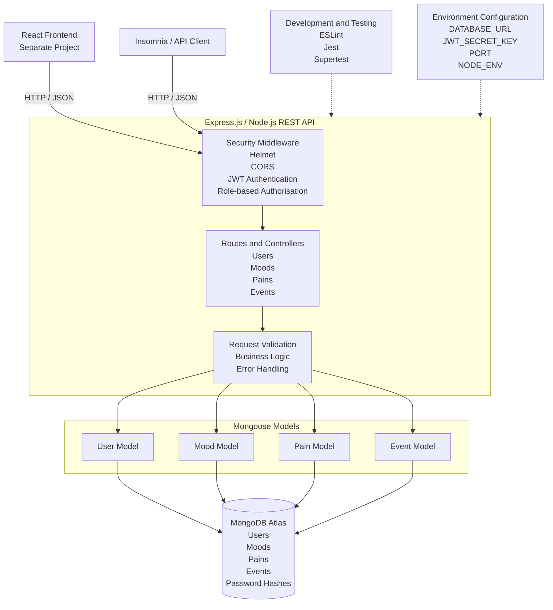
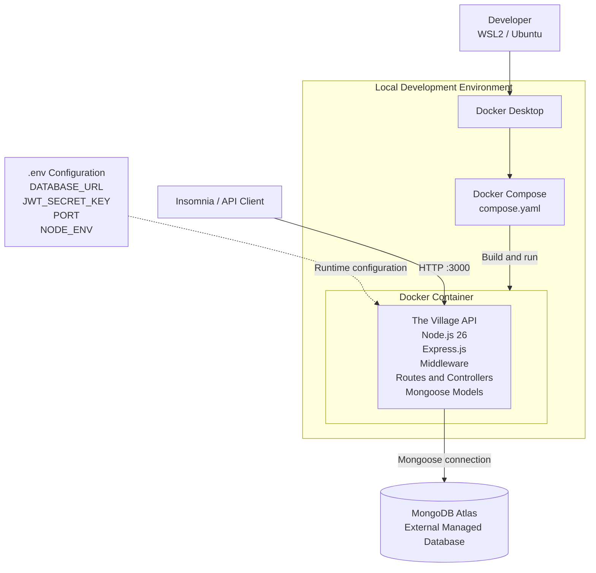
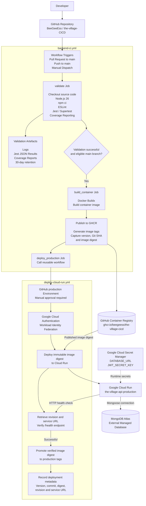
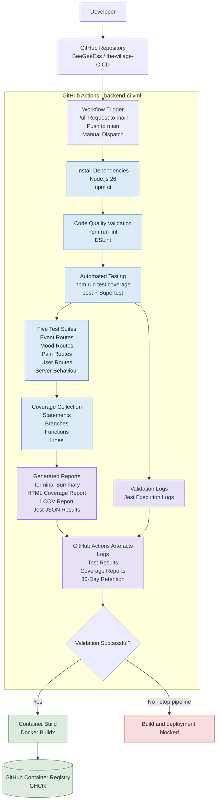

# Explanation of Application Architecture

## 1. Application Architecture

The Village Wellness App uses a client-server architecture. The React frontend communicates with a separately maintained Express.js and Node.js REST API, which processes requests and manages application data stored in MongoDB Atlas through Mongoose.

The frontend and backend are maintained in separate GitHub repositories and deployed independently. This document focuses on the backend architecture, containerisation and CI/CD implementation. The frontend README provides additional documentation about the frontend application's technologies, structure, testing and deployment.

For further information, refer to the [Frontend Repository README](https://github.com/The-Village-Wellness-App/village-frontend/blob/main/README.md).



**Figure 1: Application Architecture**

### 1.1 Client Layer

The application has two client interfaces:

- **React frontend:** A separately maintained application that communicates with the backend through HTTP requests and JSON responses. Refer to the [Frontend Repository README](https://github.com/The-Village-Wellness-App/village-frontend/blob/main/README.md) for frontend documentation.
- **Insomnia:** An API testing client used to send requests directly to the backend and verify application behaviour independently of the frontend.

For local development, the API can be accessed through:

`http://localhost:3000`

### 1.2 Frontend Architecture

The React frontend is maintained in a separate GitHub repository and has its own development, testing and deployment processes.

It communicates with the backend through the REST API but is not included in this repository's Docker image or backend CI/CD workflow.

For further information about the frontend application, technologies, structure, testing and deployment, refer to the [Frontend Repository README](https://github.com/The-Village-Wellness-App/village-frontend/blob/main/README.md).

### 1.3 Express.js and Node.js API

The backend is implemented using Node.js and Express.js. Express provides the HTTP server and routing framework used to expose REST-style endpoints.

The API manages four main application resources:

- Users
- Moods
- Pains
- Events

Routes direct incoming requests to the appropriate controllers, which handle application logic and communicate with the relevant Mongoose models.

### 1.4 Security

The API incorporates several security mechanisms:

- **Helmet:** Applies security-related HTTP headers.
- **CORS:** Controls cross-origin access to the API.
- **JWT authentication:** Uses JSON Web Tokens to verify authenticated requests.
- **Role-based authorisation:** Restricts access to protected endpoints according to user roles.

JWT signing uses the `JWT_SECRET_KEY` environment variable rather than a secret embedded in the source code.

### 1.5 Validation and Error Handling

Request validation and Mongoose schemas help ensure that application data is appropriately structured before it is stored.

The API also returns HTTP error responses to communicate request and application errors consistently. These include:

| Status | Purpose               |
| ------ | --------------------- |
| `400`  | Bad Request           |
| `401`  | Unauthorised          |
| `403`  | Forbidden             |
| `404`  | Not Found             |
| `500`  | Internal Server Error |

### 1.6 Data Layer

MongoDB Atlas provides managed persistent storage for the application.

Mongoose provides the object data modelling layer between the Express application and MongoDB Atlas. The application uses separate models for Users, Moods, Pains and Events.

User passwords are stored as password hashes rather than plain-text passwords.

The database remains external to the application container. This keeps persistent application data separate from the container lifecycle.

### 1.7 Testing, Coverage and Configuration

The backend uses automated testing and static code analysis to validate application quality and behaviour.

The testing tools include:

| Technology | Purpose                                      |
| ---------- | -------------------------------------------- |
| ESLint     | Static code analysis and code-quality checks |
| Jest       | Automated testing framework                  |
| Supertest  | HTTP testing of Express endpoints            |

The current test suite contains five test files covering:

- Event routes and controllers.
- Mood routes and controllers.
- Pain routes and controllers.
- User routes and authentication behaviour.
- Server behaviour.

The main validation commands are:

```bash
npm run lint
npm test
```

To execute the test suite and generate coverage reports:

```bash
npm run test:coverage
```

Jest collects coverage across four metrics:

| Metric     | Description                                |
| ---------- | ------------------------------------------ |
| Statements | Percentage of executable statements tested |
| Branches   | Percentage of conditional branches tested  |
| Functions  | Percentage of functions tested             |
| Lines      | Percentage of executable lines tested      |

The locally generated baseline on 15 November 2026 was:

| Coverage Metric | Result |
| --------------- | -----: |
| Statements      | 64.15% |
| Branches        | 43.28% |
| Functions       | 68.00% |
| Lines           | 64.65% |

This baseline was generated from five passing test suites containing 19 passing tests. It provides a starting point for monitoring test coverage and identifying areas where additional tests may be beneficial.

Jest generates terminal, HTML and LCOV coverage reports. The HTML report can be inspected locally at `coverage/index.html`.

Application configuration is supplied through environment variables:

| Variable            | Purpose                                                 |
| ------------------- | ------------------------------------------------------- |
| `DATABASE_URL`      | MongoDB Atlas connection string for application runtime |
| `TEST_DATABASE_URL` | MongoDB connection string for automated testing         |
| `JWT_SECRET_KEY`    | Secret used for JWT operations                          |
| `PORT`              | Port used by the Express server                         |
| `NODE_ENV`          | Identifies the application environment                  |

For local development, configuration values are supplied through a `.env` file. Sensitive configuration files are excluded from source control.

The coverage baseline represents a local test execution and should not be interpreted as a verified GitHub Actions result.

---

## 2. Containerised Architecture

Docker is used to package the Express.js backend and its runtime dependencies into a container image.

The containerised architecture builds on the existing application architecture. The API runs inside a Docker container, while MongoDB Atlas remains an external managed database.



**Figure 2: Containerised Application Architecture**

### 2.1 Docker Image

The project uses a Dockerfile to define how the backend container image is built.

The image uses the official Node.js 26 Alpine base image:

```dockerfile
FROM node:26-alpine
```

Alpine provides a lightweight Linux environment, helping to reduce the overall image size.

The Dockerfile copies the package files before installing dependencies:

```dockerfile
COPY package*.json ./
RUN npm ci --omit=dev
```

This uses the package lock file to install reproducible dependencies. The `--omit=dev` option excludes development-only dependencies from the runtime image.

The application source is then copied into the image:

```dockerfile
COPY src ./src
```

The Dockerfile configures the application port:

```dockerfile
ENV PORT=8080
EXPOSE 8080
```

Port `8080` is the default runtime port used by the image, including for compatibility with Google Cloud Run. The local Docker Compose configuration overrides this value for local development.

The container also runs using the non-root `node` user:

```dockerfile
USER node
```

Running the application as a non-root user reduces the privileges available to the application process inside the container.

Sensitive configuration is not embedded in the image. Database credentials and authentication secrets are supplied at runtime through environment variables.

### 2.2 Docker Compose

Docker Compose defines the local development container configuration through `compose.yaml`.

The configuration builds the application from the project's Dockerfile and maps the local development port:

```yaml
ports:
  - '3000:3000'
```

It also supplies the local environment configuration:

```yaml
env_file:
  - .env

environment:
  NODE_ENV: development
  PORT: 3000
```

This overrides the Dockerfile's default port for local development.

The container can be built and started using:

```bash
docker compose build
docker compose up
```

The API is then available at:

`http://localhost:3000`

To stop the development container:

```bash
docker compose down
```

### 2.3 External Database

MongoDB Atlas remains outside the Docker container.

The application connects to the database through the `DATABASE_URL` environment variable. This separation ensures that persistent application data is not tied to the lifecycle of an individual container.

The container can therefore be rebuilt or replaced without storing the application's persistent data inside the image.

---

## 3. CI/CD Architecture

GitHub Actions automates application validation, Docker image building, image publishing and production deployment.

GitHub Container Registry (GHCR) stores the published container images. GitHub Environments provides a manual approval checkpoint before production deployment can proceed.

The implementation uses two workflow files:

- `.github/workflows/backend-ci.yml` — coordinates validation, container image publishing and production deployment.
- `.github/workflows/deploy-cloud-run.yml` — reusable workflow responsible for the protected production deployment to Google Cloud Run.

The reusable deployment workflow is called by the main workflow through `workflow_call`.



**Figure 3: CI/CD and Production Deployment Architecture**

### 3.1 Workflow Triggers and Continuous Integration

The main workflow, `backend-ci.yml`, is triggered by:

- Pull requests targeting `main`.
- Pushes to `main`.
- Manual workflow dispatch.

The `validate` job runs for all three triggers. It performs the following steps:

1. Checks out the repository.
2. Configures Node.js 26.
3. Installs dependencies using `npm ci`.
4. Runs ESLint using `npm run lint`.
5. Runs the automated Jest and Supertest suite with coverage using `npm run test:coverage`.
6. Generates a structured Jest JSON test-results report.
7. Uploads validation logs, test results and available coverage reports as GitHub Actions artefacts.

Linting and automated tests act as quality gates. If these checks fail, the dependent container build cannot proceed.

Validation artefacts are retained for 30 days. The artefact upload step is configured to run even when validation fails, allowing available diagnostic output to be retained for troubleshooting.

Container image building and production deployment are restricted to eligible runs targeting the `main` branch. Pull requests therefore validate changes without publishing or deploying a container image.

Manual workflow dispatch also requires the run to target `main` before the build and deployment stages can proceed.

### 3.2 Automated Testing and Coverage

Jest and Supertest are used to test the backend application and its HTTP endpoints.

The test suite currently contains five test files covering the event, mood, pain and user routes, as well as server behaviour.

The tests execute within the GitHub Actions validation workflow before the Docker image is built and published.

The validation job runs:

```bash
npm run lint
npm run test:coverage
```

The coverage-enabled test command generates terminal, HTML and LCOV coverage reports. The GitHub Actions workflow also produces a structured Jest JSON test-results report using additional Jest command-line arguments.

The validation process produces the following outputs:

- **Terminal coverage summary:** Displays the overall coverage results after test execution.
- **HTML coverage report:** Allows individual files, covered lines and uncovered lines to be inspected.
- **LCOV report:** Provides coverage data in a format compatible with other coverage tools.
- **Jest JSON test-results report:** Contains structured test execution results generated separately by the GitHub Actions workflow.

The validation job receives its configuration through environment variables and GitHub repository secrets:

| Variable            | Purpose                                         |
| ------------------- | ----------------------------------------------- |
| `TEST_DATABASE_URL` | MongoDB connection string for automated testing |
| `JWT_SECRET_KEY`    | Secret used for JWT operations                  |
| `PORT`              | Application port for the test environment       |
| `NODE_ENV`          | Identifies the test environment                 |

The test database connection is kept separate from the application's runtime database configuration. This prevents automated tests from relying on the production database connection.

Validation logs, structured test results and available coverage reports are uploaded as GitHub Actions artefacts and retained for 30 days. This allows test execution and coverage information to be inspected after a workflow run.

Development dependencies, including Jest and Supertest, are excluded from the final runtime image through:

```dockerfile
RUN npm ci --omit=dev
```

This keeps testing tools separate from the production application dependencies.



**Figure 4: Automated Testing and Coverage Workflow**

### 3.3 Container Image Building and Publishing

Following successful validation, eligible runs targeting `main` proceed to the `build_container` job.

Docker Buildx builds the container image using the repository's Dockerfile. GitHub Actions authenticates with GitHub Container Registry using the GitHub-provided `GITHUB_TOKEN` and publishes the image to:

`ghcr.io/beegeess/the-village-cicd`

The workflow generates the following image tags:

| Tag               | Purpose                                           |
| ----------------- | ------------------------------------------------- |
| `latest`          | Most recently published image                     |
| `development`     | Development image reference                       |
| `testing`         | Testing image reference                           |
| `{version}`       | Application version derived from `package.json`   |
| `sha-{short-sha}` | Identifies the Git commit used to build the image |

These tags identify the image produced by the main-branch build. They do not represent separate deployed development and testing environments.

The workflow also captures the application version, Git commit SHA and immutable image digest. The digest is passed to the deployment workflow so that production uses the exact image that was built and published.

### 3.4 Production Deployment

Production deployment is handled by the reusable workflow:

`.github/workflows/deploy-cloud-run.yml`

The main workflow calls this reusable workflow through the `deploy_production` job after the container image has been published.

The deployment uses a protected GitHub Environment named `production`. An authorised reviewer must approve the deployment before the protected deployment steps can proceed.

After approval, GitHub Actions authenticates with Google Cloud using Workload Identity Federation (WIF). This avoids the need to store a long-lived Google Cloud service account key in GitHub repository secrets.

The deployment workflow then deploys the published container image to the Cloud Run service:

`the-village-api-production`

The deployment uses the immutable image digest rather than relying on a mutable image tag. This ensures that the deployed image is the same image produced by the preceding build and publishing process.

### 3.5 Runtime Configuration and Secrets

Sensitive runtime configuration is managed separately from the container image.

Google Cloud Secret Manager provides the following application secrets to the Cloud Run service:

| Secret           | Purpose                         |
| ---------------- | ------------------------------- |
| `DATABASE_URL`   | MongoDB Atlas connection string |
| `JWT_SECRET_KEY` | Secret used for JWT operations  |

The Cloud Run service runs the container on port `8080` and connects to MongoDB Atlas as an external managed database.

This approach keeps sensitive credentials outside the source code and container image while allowing the same image to be deployed without embedding environment-specific configuration.

### 3.6 Deployment Health Verification

After deploying the container, the workflow retrieves the Cloud Run revision and service URL.

It then checks the application's `/health` endpoint to verify that the deployed service is responding successfully.

The health check retries up to 12 times, with a five-second interval between failed attempts.

If the health check succeeds, the deployment is considered verified and the workflow promotes the same immutable image digest to the following production tags:

| Tag                    | Purpose                                                      |
| ---------------------- | ------------------------------------------------------------ |
| `production`           | Most recently verified production image                      |
| `production-{version}` | Verified production image for a specific application version |

For example, an application version of `1.0.0` results in the production tag `production-1.0.0`.

If health verification does not succeed, the production tags are not promoted.

The workflow also records deployment metadata, including the application version, Git commit, image digest, Cloud Run revision and service URL. This metadata is uploaded as a GitHub Actions artefact with a 30-day retention period.

### 3.7 Production Image Retrieval

Published container images can be retrieved independently of the local development environment.

For example, the verified production image can be pulled from GHCR using:

```bash
docker pull ghcr.io/beegeess/the-village-cicd:production
```

The image can also be run locally with the required runtime environment variables supplied separately:

```bash
docker run --env-file .env.production -p 8080:8080 ghcr.io/beegeess/the-village-cicd:production
```

The local environment file must contain the required runtime configuration, including `DATABASE_URL` and `JWT_SECRET_KEY`. It must not be committed to source control.

This provides a way to inspect the production-tagged image independently of the Cloud Run deployment process.

---

## 4. Application Technology Selection and Justification

The technologies used to develop The Village Wellness App were selected based on their suitability for the application's requirements, integration capabilities, maintainability, security and development complexity.

The application uses the MERN stack, comprising MongoDB, Express.js, React and Node.js. This combination provides a JavaScript-based development environment across the frontend and backend, with MongoDB providing document-oriented data storage.

The selection was intended to provide a consistent development experience while supporting the application's client-server architecture and its requirements for data management, authentication and API communication.

### 4.1 MERN Stack

The MERN stack was selected because it provides an integrated set of technologies for developing a full-stack web application.

Using JavaScript across the frontend and backend reduces the need to maintain separate programming language ecosystems for application development. It also allows development knowledge and some programming concepts to be applied across both projects.

The technologies have distinct responsibilities:

- **MongoDB:** Stores application data in a document-oriented database.
- **Express.js:** Provides the backend HTTP server and REST API framework.
- **React:** Provides the component-based frontend user interface.
- **Node.js:** Provides the JavaScript runtime for the backend.

The MERN stack was considered appropriate for the application's requirements because it supports independent frontend and backend development while providing a consistent technology ecosystem.

### 4.2 Node.js and Express.js

Node.js was selected as the backend runtime because it allows JavaScript to be used on both the frontend and backend. Its asynchronous, event-driven architecture is suitable for handling API requests and database operations (OpenJS Foundation, n.d.).

Express.js was selected as the backend framework because it provides a lightweight approach to defining routes, handling HTTP requests and responses, and applying middleware.

Its middleware architecture supports the integration of security controls, authentication, validation and error handling without requiring a more complex application framework (Express.js, n.d.).

Together, Node.js and Express.js provide the backend foundation required to expose the application's REST API and process requests from the React frontend.

### 4.3 React

React was selected for the frontend because its component-based architecture supports reusable interface elements and separation of presentation into manageable components.

This approach supports maintainability as the application grows and allows interface components to be developed and updated independently.

React also provides an established ecosystem of development tools and libraries, supporting the frontend's routing, user interface and testing requirements (Meta Open Source, n.d.).

The frontend is maintained and deployed separately from the backend, allowing each application to evolve independently while communicating through the REST API.

### 4.4 MongoDB Atlas and Mongoose

MongoDB Atlas was selected as the application's database platform because its document-oriented model is suitable for storing the application's structured resources, including users, moods, pains and events.

MongoDB stores data as flexible documents, allowing related application information to be represented without requiring every resource to follow a rigid relational table structure (MongoDB, n.d.-a).

Atlas provides a managed database service, removing the need to provision and maintain a separate database server for the project.

Mongoose was selected as the object data modelling layer between the Node.js application and MongoDB. It provides schema definitions, validation and model-based interactions with the database, helping to maintain consistent data structures within the application (Mongoose, n.d.).

The combination of MongoDB Atlas and Mongoose provides managed persistence while allowing the backend to define and validate its application data through JavaScript models.

### 4.5 Authentication and Security Technologies

JSON Web Tokens (JWT) were selected to support authenticated API requests. JWTs allow the backend to issue signed tokens that can be presented by clients when accessing protected endpoints.

This approach supports authentication across the separately maintained frontend and backend without requiring the API to maintain a traditional server-side session for each authenticated user (IETF, 2015).

Helmet was selected to apply security-related HTTP headers to the Express application. This provides an additional layer of protection through commonly recommended browser security headers (Helmet, n.d.).

CORS middleware was included to control which origins are permitted to access the API through cross-origin browser requests. This is important because the frontend and backend are separately hosted applications (Express.js, n.d.).

These technologies were selected because they integrate with the Express middleware architecture and support the application's authentication and security requirements without introducing an unnecessary additional framework.

---

## 5. DevOps and Infrastructure Technology Selection and Justification

The technologies used for containerisation, CI/CD, hosting and deployment were selected based on their suitability for the project, integration capabilities, ease of use, security and ongoing operating costs.

A key design consideration was to minimise additional costs while still implementing a modern and maintainable deployment architecture. Where possible, existing platforms and their available free features were preferred over introducing additional paid subscriptions or infrastructure.

The term _free_ in this section refers to the services and usage allowances available to this project at the time of implementation, based on its current configuration and usage. It does not imply that these services are permanently free or that costs cannot arise if usage increases, allowances change or providers update their pricing. The selected services and their associated costs will need to be reviewed as the application evolves.

### 5.1 GitHub and GitHub Actions

GitHub was selected as the central platform for source code management, version control, collaboration and CI/CD automation.

GitHub provides an accessible environment for managing repositories, tracking changes, reviewing code and maintaining separate frontend and backend projects. Its support for open-source development, together with the features available under its free plan, made it a suitable choice for this project. GitHub Free currently provides unlimited public and private repositories and an included allowance for CI/CD usage (GitHub, n.d.-a).

GitHub Actions was selected to automate code validation, testing, container image publishing and deployment. Maintaining workflow definitions alongside the application source code simplifies configuration and allows the CI/CD process to be version-controlled with the application.

GitHub also provides repository and environment secrets for securely supplying configuration values and deployment credentials to workflow executions. Actions artefacts can be used to retain test results, coverage reports and other build outputs, providing traceability and supporting validation of the development process.

Using GitHub Actions avoided introducing a separate CI/CD platform, such as Jenkins or CircleCI, reducing the number of services requiring configuration and administration.

The decision to use GitHub's included features was based on the project's current requirements and usage, rather than an assumption that all GitHub functionality is unlimited or permanently free. GitHub applies usage allowances and billing limits to Actions compute and storage, particularly for private repositories (GitHub, n.d.-b; GitHub, n.d.-c).

### 5.2 Docker and Docker Compose

Docker was selected to package the backend application and its runtime dependencies into a portable container image.

Containerisation provides a consistent application environment across development, testing and production. This reduces reliance on differences between individual development machines and the production hosting environment.

The Dockerfile defines the application runtime, dependency installation, exposed port and non-root execution user. This provides a repeatable method for building the backend image and ensures that development dependencies are excluded from the production runtime image.

Docker Compose was selected to simplify local container management. It defines the local development configuration, including port mapping and environment variables, without requiring developers to manually configure and run the container.

Docker and Docker Compose were therefore selected to support consistent development and deployment while keeping the local environment straightforward to operate (Docker, n.d.-a; Docker, n.d.-b).

### 5.3 GitHub Container Registry (GHCR)

GitHub Container Registry (GHCR) was selected to store and distribute the Docker images produced by the CI/CD pipeline.

GHCR integrates directly with GitHub Actions, allowing container images to be built and published using the existing repository permissions and workflow authentication. This avoids the need to maintain a separate registry account and additional credentials.

Google Cloud Artifact Registry was considered as an alternative because of its integration with Cloud Run. However, its free storage allowance is limited to 0.5 GiB per billing account, with additional storage charged according to usage (Google Cloud, n.d.-a). This was considered restrictive for retaining multiple versioned container images.

GHCR was therefore preferred because GitHub currently provides free container image storage and bandwidth through its Container Registry. GitHub's package billing arrangements and policies are subject to change, so this decision reflects the pricing available to the project at the time of implementation (GitHub, n.d.-c).

Using GHCR also keeps source code, workflow definitions and container images within the same development ecosystem. Version tags and immutable image digests provide traceability between the source code, published image and deployed application.

This decision reflects the project's current storage requirements and the available pricing arrangements. GHCR's pricing and usage policies will need to be reassessed if the application grows or the provider changes its terms.

### 5.4 Netlify – Frontend Hosting

Netlify was retained as the frontend hosting and deployment platform because of its ease of use and straightforward integration with GitHub.

The platform supports automated deployments from a connected Git repository, allowing frontend changes to be built and published without requiring a separately maintained deployment server or custom infrastructure. Netlify also provides deployment previews and global content delivery through its CDN.

Netlify's available free plan currently provides a $0 entry-level option with deployment previews and other hosting features, subject to monthly usage limits (Netlify, n.d.). This was suitable for the project's current frontend hosting requirements.

Alternative hosting options, including Google Cloud Run and other cloud hosting services, were considered. However, moving the frontend to another platform would introduce additional configuration and deployment responsibilities without providing a significant benefit for the application's current requirements.

Retaining Netlify therefore allowed the existing deployment process to continue while keeping the frontend and backend independently maintained and deployed.

### 5.5 Google Cloud Run – Backend Hosting

Google Cloud Run was selected to host the containerised backend API.

Cloud Run provides a managed container execution environment, allowing the application to be deployed without provisioning or maintaining virtual machines or a container orchestration platform. It automatically scales instances in response to incoming requests and can scale to zero when minimum instances are not configured.

Its usage-based billing model was an important consideration. Rather than requiring continuously provisioned compute resources, Cloud Run charges according to resource consumption, with an included monthly free usage allowance (Google Cloud, n.d.-b). This makes it suitable for an application with relatively low or variable traffic.

AWS services, including AWS App Runner, were considered as alternatives. AWS App Runner also provides managed container hosting and usage-based pricing. However, its pricing model includes charges for provisioned container instances, even when they are idle, under its default configuration (Amazon Web Services, n.d.). Cloud Run was preferred because its scale-to-zero capability and pricing structure were considered more appropriate for the project's expected usage.

Cloud Run was also selected because of its ease of deployment and integration with other Google Cloud services used by the application, including Secret Manager and Identity and Access Management (IAM). This provides a consistent environment for deployment, runtime configuration and access control.

### 5.6 Google Cloud Secret Manager

Google Cloud Secret Manager was selected to manage sensitive application configuration required by the production backend.

GitHub Actions secrets are used to supply credentials during CI/CD workflow execution. However, production application secrets have different requirements because the backend needs access to sensitive configuration at runtime, independently of the deployment workflow.

Secret Manager provides a dedicated service for storing and controlling access to these values. The Cloud Run service can access its required secrets, including the MongoDB connection string and JWT signing key, without embedding them in the source code or Docker image.

This separation improves security and allows sensitive configuration to be managed independently of application releases. It also supports controlled access through Google Cloud IAM.

Secret Manager was preferred over relying exclusively on GitHub repository secrets because GitHub Actions secrets are intended for workflow execution, whereas Google Cloud Secret Manager provides runtime secret management integrated with the production hosting environment.

Google Cloud currently provides a free usage allowance for Secret Manager, including a limited number of active secret versions and access operations per month. Usage beyond these allowances may incur charges (Google Cloud, n.d.-c). Its selection was therefore based on its security capabilities, integration with Cloud Run and suitability within the project's current expected usage.

### 5.7 Google Cloud Artifact Registry – Alternative Considered

Google Cloud Artifact Registry was considered as the container image storage option because of its integration with Cloud Run and the wider Google Cloud ecosystem.

However, its free storage allowance of 0.5 GiB per billing account was considered insufficient for the intended retention of multiple versioned container images without potentially incurring additional storage costs (Google Cloud, n.d.-a).

GHCR provided a more suitable option because it integrates directly with the existing GitHub workflows and currently provides free container image storage and bandwidth.

Consequently, the architecture uses GHCR to store container images and Google Cloud Run to execute them. This separates image storage from application hosting while allowing the deployment workflow to retrieve the required image using its immutable digest.

### 5.8 Summary of Technology Decisions

The final technology choices reflect a preference for integrated, accessible and cost-conscious services without compromising the architectural requirements of the application.

| Requirement                | Selected Technology         | Alternative Considered    | Justification                                                                                                      |
| -------------------------- | --------------------------- | ------------------------- | ------------------------------------------------------------------------------------------------------------------ |
| Source control             | GitHub                      | GitLab, Bitbucket         | Integrated repository management, usability and included features suitable for the project's current requirements. |
| CI/CD automation           | GitHub Actions              | Jenkins, CircleCI         | Integrated with GitHub repositories and provides the required automation without introducing another platform.     |
| Containerisation           | Docker                      | Podman                    | Portable application packaging and a consistent runtime environment.                                               |
| Local container management | Docker Compose              | Manual Docker commands    | Simplifies local configuration and container management.                                                           |
| Frontend hosting           | Netlify                     | Google Cloud Run, Vercel  | Ease of use, straightforward Git integration and deployment previews.                                              |
| Backend hosting            | Google Cloud Run            | AWS App Runner, AWS ECS   | Managed container hosting, scale-to-zero capability, usage-based pricing and Google Cloud integration.             |
| Container registry         | GitHub Container Registry   | Google Artifact Registry  | Direct GitHub integration and currently suitable container image storage and pricing for the project.              |
| Runtime secrets            | Google Cloud Secret Manager | GitHub Actions secrets    | Dedicated runtime secret management integrated with Cloud Run and IAM.                                             |
| Build and test artefacts   | GitHub Actions Artifacts    | External artefact storage | Keeps validation and deployment evidence alongside the CI/CD workflows, within the available usage allowance.      |

Overall, this approach avoids unnecessary duplication of services and reduces the number of platforms requiring separate configuration and administration. GitHub provides the central development and automation environment, while Netlify and Google Cloud provide hosting services suited to the distinct requirements of the frontend and backend.

The architecture is not dependent on a single provider for every service. Instead, each technology was selected according to its purpose, integration capabilities and suitability for the project's current requirements. This provides a cost-conscious foundation while retaining the flexibility to adopt alternative services if application requirements, usage or pricing arrangements change.

---

## References

Amazon Web Services. (n.d.). _AWS App Runner pricing_. [https://aws.amazon.com/apprunner/pricing/](https://aws.amazon.com/apprunner/pricing/)

Docker. (n.d.-a). _Docker overview_. [https://docs.docker.com/get-started/docker-overview/](https://docs.docker.com/get-started/docker-overview/)

Docker. (n.d.-b). _Docker Compose_. [https://docs.docker.com/compose/](https://docs.docker.com/compose/)

Express.js. (n.d.). _Express documentation_. [https://expressjs.com/](https://expressjs.com/)

GitHub. (n.d.-a). _Plans and pricing_. [https://github.com/pricing](https://github.com/pricing)

GitHub. (n.d.-b). _Billing and usage_. GitHub Docs. [https://docs.github.com/en/actions/concepts/billing-and-usage](https://docs.github.com/en/actions/concepts/billing-and-usage)

GitHub. (n.d.-c). _GitHub Packages billing_. GitHub Docs. [https://docs.github.com/en/billing/concepts/product-billing/](https://docs.github.com/en/billing/concepts/product-billing/github-packages)

Google Cloud. (n.d.-a). _Artifact Registry pricing_. [https://cloud.google.com/artifact-registry/pricing](https://cloud.google.com/artifact-registry/pricing)

Google Cloud. (n.d.-b). _Cloud Run pricing_. [https://cloud.google.com/run/pricing](https://cloud.google.com/run/pricing)

Google Cloud. (n.d.-c). _Secret Manager pricing_. [https://cloud.google.com/secret-manager/pricing](https://cloud.google.com/secret-manager/pricing)

Helmet. (n.d.). _Helmet documentation_. [https://helmetjs.github.io/](https://helmetjs.github.io/)

IETF. (2015). _JSON Web Token (JWT)_ (RFC 7519). [https://www.rfc-editor.org/rfc/rfc7519](https://www.rfc-editor.org/rfc/rfc7519)

Meta Open Source. (n.d.). _React documentation_. [https://react.dev/](https://react.dev/)

MongoDB. (n.d.-a). _Documents_. MongoDB Manual. [https://www.mongodb.com/docs/manual/core/document/](https://www.mongodb.com/docs/manual/core/document/)

Mongoose. (n.d.). _Mongoose documentation_. [https://mongoosejs.com/docs/](https://mongoosejs.com/docs/)

Netlify. (n.d.). _Pricing and plans_. [https://www.netlify.com/pricing/](https://www.netlify.com/pricing/)

OpenJS Foundation. (n.d.). _Node.js documentation_. [https://nodejs.org/docs/](https://nodejs.org/docs/)
