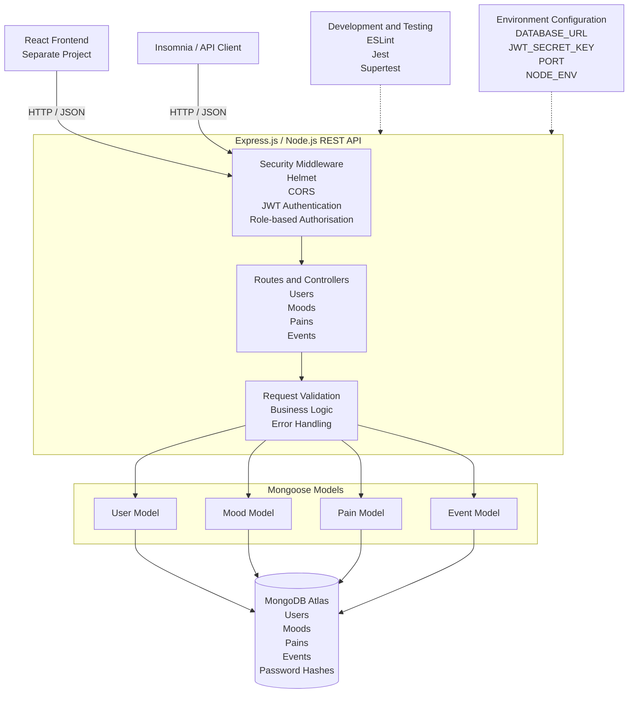
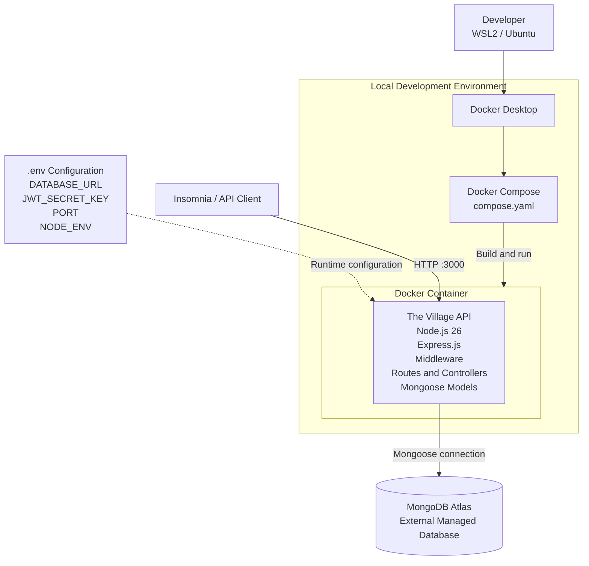
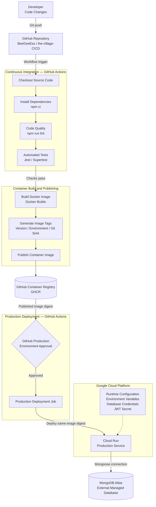

# Explanation of Application Architecture

## 1. Application Architecture

The Village Wellness App uses a client-server architecture. A separate React frontend communicates with an Express.js and Node.js REST API, which processes requests and manages application data stored in MongoDB Atlas through Mongoose.

The backend is the focus of this project. The React frontend is shown for architectural context but is maintained separately.



**Figure 1: Application Architecture**

### 1.1 Client Layer

The application has two client interfaces:

- **React frontend:** A separate project that communicates with the backend through HTTP requests and JSON responses.
- **Insomnia:** An API testing client used to send requests directly to the backend and verify application behaviour independently of the frontend.

For local development, the API can be accessed through:

`http://localhost:3000`

The frontend is outside the scope of this containerisation and CI/CD project.

### 1.2 Express.js and Node.js API

The backend is implemented using Node.js and Express.js. Express provides the HTTP server and routing framework used to expose REST-style endpoints.

The API manages four main application resources:

- Users
- Moods
- Pains
- Events

Routes direct incoming requests to the appropriate controllers, which handle application logic and communicate with the relevant Mongoose models.

### 1.3 Security

The API incorporates several security mechanisms:

- **Helmet:** Applies security-related HTTP headers.
- **CORS:** Controls cross-origin access to the API.
- **JWT authentication:** Uses JSON Web Tokens to verify authenticated requests.
- **Role-based authorisation:** Restricts access to protected endpoints according to user roles.

JWT signing uses the `JWT_SECRET_KEY` environment variable rather than a secret embedded in the source code.

### 1.4 Validation and Error Handling

Request validation and Mongoose schemas help ensure that application data is appropriately structured before it is stored.

The API also returns HTTP error responses to communicate request and application errors consistently. These include:

| Status | Purpose |
| --- | --- |
| `400` | Bad Request |
| `401` | Unauthorised |
| `403` | Forbidden |
| `404` | Not Found |
| `500` | Internal Server Error |

### 1.5 Data Layer

MongoDB Atlas provides managed persistent storage for the application.

Mongoose provides the object data modelling layer between the Express application and MongoDB Atlas. The application uses separate models for Users, Moods, Pains and Events.

User passwords are stored as password hashes rather than plain-text passwords.

The database remains external to the application container. This keeps persistent application data separate from the container lifecycle.

### 1.6 Testing and Configuration

The project uses the following tools to validate application quality and behaviour:

| Technology | Purpose |
| --- | --- |
| ESLint | Static code analysis and code-quality checks |
| Jest | Automated testing framework |
| Supertest | HTTP testing of Express endpoints |

The main validation commands are:

```bash
npm run lint
npm test
```

Application configuration is supplied through environment variables:

| Variable | Purpose |
| --- | --- |
| `DATABASE_URL` | MongoDB Atlas connection string |
| `JWT_SECRET_KEY` | Secret used for JWT operations |
| `PORT` | Port used by the Express server |
| `NODE_ENV` | Application environment |

For local development, these values are supplied through a `.env` file. Sensitive configuration files are excluded from source control.

---

## 2. Containerised Architecture

Docker is used to package the Express.js backend and its runtime dependencies into a container image.

The containerised architecture builds on the existing application architecture. The API runs inside a Docker container, while MongoDB Atlas remains an external managed database.



**Figure 2: Containerised Application Architecture**

### 2.1 Docker Image

The project uses a Dockerfile to define how the backend container image is built.

The image uses the official Node.js 26 Alpine base image:

```dockerfile
FROM node:26-alpine
```

Alpine provides a lightweight Linux environment, helping to reduce the overall image size.

The Dockerfile copies the package files before installing dependencies:

```dockerfile
COPY package*.json ./
RUN npm ci --omit=dev
```

This uses the package lock file to install reproducible dependencies. The `--omit=dev` option excludes development-only dependencies from the runtime image.

The application source is then copied into the image:

```dockerfile
COPY src ./src
```

The Dockerfile configures the application port:

```dockerfile
ENV PORT=8080
EXPOSE 8080
```

Port `8080` is the default runtime port used by the image, including for compatibility with Cloud Run. The local Docker Compose configuration overrides this value for local development.

The container also runs using the non-root `node` user:

```dockerfile
USER node
```

Running the application as a non-root user reduces the privileges available to the application process inside the container.

Sensitive configuration is not embedded in the image. Database credentials and authentication secrets are supplied at runtime through environment variables.

### 2.2 Docker Compose

Docker Compose defines the local development container configuration through `compose.yaml`.

The configuration builds the application from the project's Dockerfile and maps the local development port:

```yaml
ports:
  - "3000:3000"
```

It also supplies the local environment configuration:

```yaml
env_file:
  - .env

environment:
  NODE_ENV: development
  PORT: 3000
```

This overrides the Dockerfile's default port for local development.

The container can be built and started using:

```bash
docker compose build
docker compose up
```

The API is then available at:

`http://localhost:3000`

### 2.3 External Database

MongoDB Atlas remains outside the Docker container.

The application connects to the database through the `DATABASE_URL` environment variable. This separation ensures that persistent application data is not tied to the lifecycle of an individual container.

The container can therefore be rebuilt or replaced without storing the application's persistent data inside the image.

---

## 3. CI/CD Architecture

GitHub Actions automates application validation, Docker image building, image publishing and production deployment.

GitHub Container Registry (GHCR) stores the published container images. GitHub Environments provides a manual approval checkpoint before the production deployment job can proceed.



**Figure 3: CI/CD and Production Deployment Architecture**

### 3.1 Continuous Integration

GitHub Actions automates the validation and container publishing process.

The workflow performs the following activities:

1. Checks out the repository.
2. Sets up the required Node.js environment.
3. Installs dependencies using `npm ci`.
4. Runs ESLint using `npm run lint`.
5. Runs the automated test suite using `npm test`.
6. Configures Docker Buildx.
7. Authenticates with GitHub Container Registry.
8. Builds the Docker image.
9. Tags and publishes the image to GHCR.

Linting and automated tests act as quality gates. If these checks fail, the workflow does not proceed to the container image publishing stage.

### 3.2 Automated Testing

Jest and Supertest are used to test the backend application and its HTTP endpoints.

The tests execute within the GitHub Actions workflow before the Docker image is built and published.

The workflow also receives the required test configuration through GitHub repository secrets, including:

- `DATABASE_URL`
- `JWT_SECRET_KEY`

This allows the automated tests to access the required configuration without committing sensitive credentials to the repository.

Development dependencies are excluded from the final runtime image through:

```dockerfile
RUN npm ci --omit=dev
```

This keeps testing tools separate from the production application dependencies.

### 3.3 Container Image Publishing

GitHub Container Registry stores the Docker images produced by the CI/CD workflow.

The repository image is:

`ghcr.io/beegeeess/the-village-cicd`

The workflow applies image tags to identify published versions and commits. These include:

| Tag | Purpose |
| --- | --- |
| `latest` | Most recently published image |
| `development` | Development image reference |
| `testing` | Testing image reference |
| `1.0.0` | Application version |
| `sha-xxxxxxx` | Specific Git commit |

Additional production-related tags can be used to identify the image selected for production deployment.

Tags provide convenient references to images, while the image digest provides an immutable identifier for a specific image.

### 3.4 Production Deployment

Production deployment is performed through Google Cloud Run.

The production deployment job is protected by a GitHub Environment named `production`.

The environment requires manual approval from an authorised reviewer before the deployment job can proceed.

The deployment process is therefore separated into two stages:

1. **Image publishing:** GitHub Actions validates the application, builds the Docker image and publishes it to GHCR.
2. **Production deployment:** Following approval, the deployment job deploys the previously published image to Cloud Run.

Using the same published image digest for production deployment ensures that the image being deployed is the image that was built and published by the workflow, rather than a newly rebuilt image.

### 3.5 Runtime Configuration

Application configuration and secrets are supplied separately from the container image.

The production service requires the appropriate runtime configuration, including:

- `DATABASE_URL`
- `JWT_SECRET_KEY`
- `PORT`
- `NODE_ENV`

The application connects to MongoDB Atlas through the configured database connection string.

This approach keeps environment-specific configuration and sensitive credentials outside the container image.

---

## 4. Architecture Justification

The architecture was selected to support separation of responsibilities, portability, security, maintainability and repeatable deployment.

| Technology | Architectural Purpose |
| --- | --- |
| React | Provides the separate frontend client |
| Node.js and Express.js | Provide the backend REST API |
| Mongoose | Provides the data modelling layer |
| MongoDB Atlas | Provides managed persistent storage |
| Docker | Packages the application and runtime dependencies |
| Docker Compose | Defines the local development container |
| GitHub Actions | Automates validation, image building and publishing |
| GitHub Container Registry | Stores versioned container images |
| GitHub Environments | Provides controlled production deployment approval |
| Google Cloud Run | Provides the production container runtime |

Containerisation provides a consistent and portable application runtime. Separating the database and runtime configuration from the image allows the application container to be replaced without embedding persistent data or environment-specific secrets.

Automated linting and testing provide a quality gate before image publishing. GHCR provides a central location for versioned images, while image digests support traceability between the published image and the production deployment.

Finally, GitHub Environment protection introduces a human approval checkpoint before production deployment. This provides additional control over changes entering the production environment.

Together, these architectural decisions establish a repeatable container build and deployment process while keeping the application, persistent data, configuration and deployment responsibilities clearly separated.
