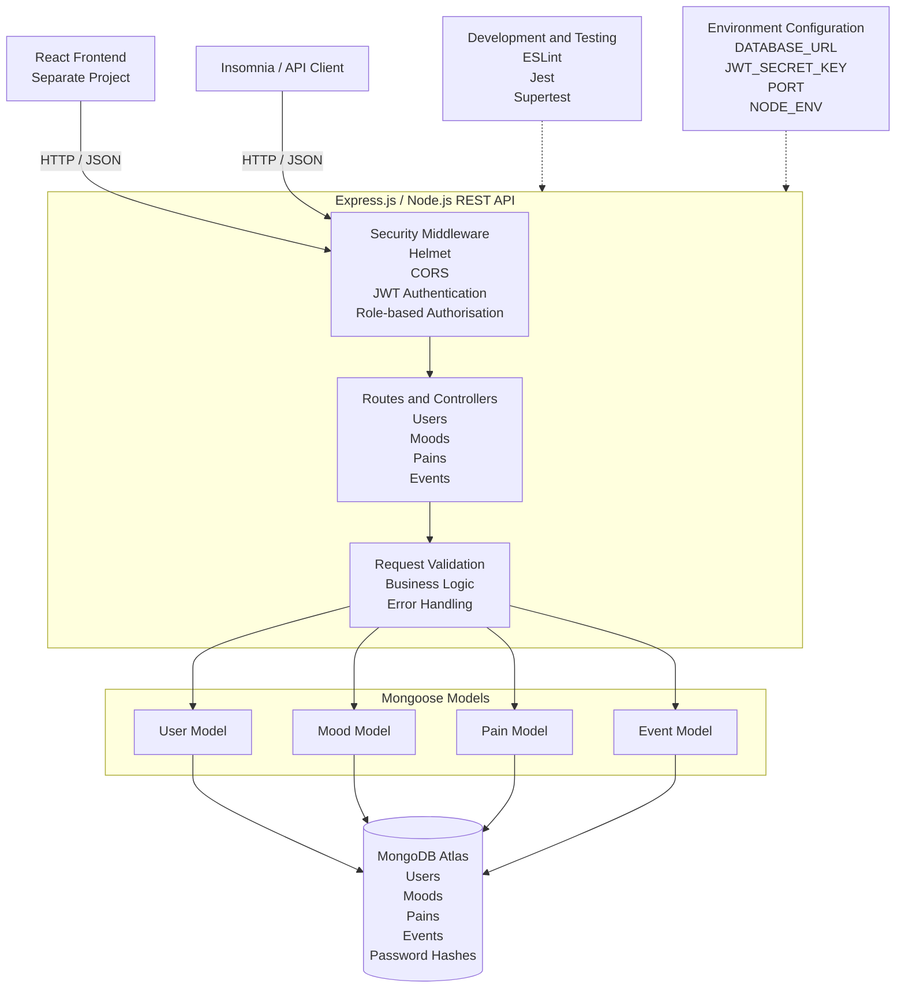
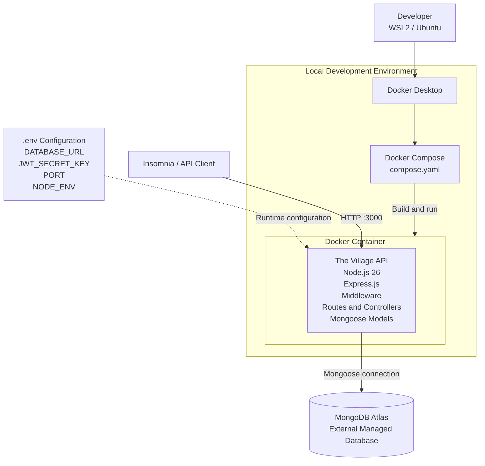
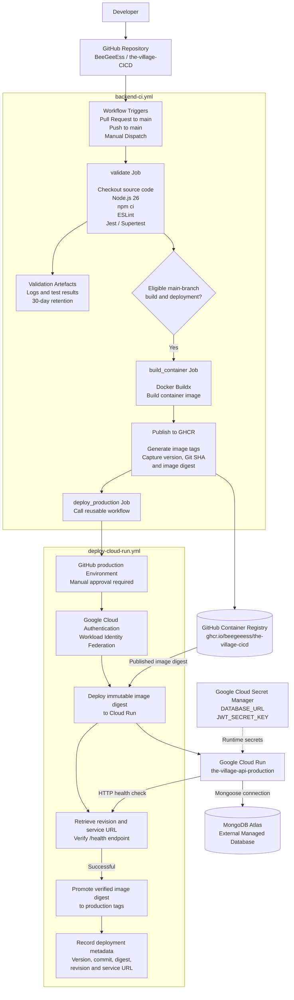

# Explanation of Application Architecture

## 1. Application Architecture

The Village Wellness App uses a client-server architecture. A separate React frontend communicates with an Express.js and Node.js REST API, which processes requests and manages application data stored in MongoDB Atlas through Mongoose.

The backend is the focus of this project. The React frontend is included for architectural context but is maintained separately.



**Figure 1: Application Architecture**

### 1.1 Client Layer

The application has two client interfaces:

- **React frontend:** A separate project that communicates with the backend through HTTP requests and JSON responses.
- **Insomnia:** An API testing client used to send requests directly to the backend and verify application behaviour independently of the frontend.

For local development, the API can be accessed through:

`http://localhost:3000`

The frontend is outside the scope of this containerisation and CI/CD project.

### 1.2 Express.js and Node.js API

The backend is implemented using Node.js and Express.js. Express provides the HTTP server and routing framework used to expose REST-style endpoints.

The API manages four main application resources:

- Users
- Moods
- Pains
- Events

Routes direct incoming requests to the appropriate controllers, which handle application logic and communicate with the relevant Mongoose models.

### 1.3 Security

The API incorporates several security mechanisms:

- **Helmet:** Applies security-related HTTP headers.
- **CORS:** Controls cross-origin access to the API.
- **JWT authentication:** Uses JSON Web Tokens to verify authenticated requests.
- **Role-based authorisation:** Restricts access to protected endpoints according to user roles.

JWT signing uses the `JWT_SECRET_KEY` environment variable rather than a secret embedded in the source code.

### 1.4 Validation and Error Handling

Request validation and Mongoose schemas help ensure that application data is appropriately structured before it is stored.

The API also returns HTTP error responses to communicate request and application errors consistently. These include:

| Status | Purpose |
| --- | --- |
| `400` | Bad Request |
| `401` | Unauthorised |
| `403` | Forbidden |
| `404` | Not Found |
| `500` | Internal Server Error |

### 1.5 Data Layer

MongoDB Atlas provides managed persistent storage for the application.

Mongoose provides the object data modelling layer between the Express application and MongoDB Atlas. The application uses separate models for Users, Moods, Pains and Events.

User passwords are stored as password hashes rather than plain-text passwords.

The database remains external to the application container. This keeps persistent application data separate from the container lifecycle.

### 1.6 Testing and Configuration

The project uses the following tools to validate application quality and behaviour:

| Technology | Purpose |
| --- | --- |
| ESLint | Static code analysis and code-quality checks |
| Jest | Automated testing framework |
| Supertest | HTTP testing of Express endpoints |

The main validation commands are:

```bash
npm run lint
npm test
```

Application configuration is supplied through environment variables:

| Variable | Purpose |
| --- | --- |
| `DATABASE_URL` | MongoDB Atlas connection string for application runtime |
| `TEST_DATABASE_URL` | MongoDB connection string for automated testing |
| `JWT_SECRET_KEY` | Secret used for JWT operations |
| `PORT` | Port used by the Express server |
| `NODE_ENV` | Identifies the application environment |

For local development, configuration values are supplied through a `.env` file. Sensitive configuration files are excluded from source control.

---

## 2. Containerised Architecture

Docker is used to package the Express.js backend and its runtime dependencies into a container image.

The containerised architecture builds on the existing application architecture. The API runs inside a Docker container, while MongoDB Atlas remains an external managed database.



**Figure 2: Containerised Application Architecture**

### 2.1 Docker Image

The project uses a Dockerfile to define how the backend container image is built.

The image uses the official Node.js 26 Alpine base image:

```dockerfile
FROM node:26-alpine
```

Alpine provides a lightweight Linux environment, helping to reduce the overall image size.

The Dockerfile copies the package files before installing dependencies:

```dockerfile
COPY package*.json ./
RUN npm ci --omit=dev
```

This uses the package lock file to install reproducible dependencies. The `--omit=dev` option excludes development-only dependencies from the runtime image.

The application source is then copied into the image:

```dockerfile
COPY src ./src
```

The Dockerfile configures the application port:

```dockerfile
ENV PORT=8080
EXPOSE 8080
```

Port `8080` is the default runtime port used by the image, including for compatibility with Google Cloud Run. The local Docker Compose configuration overrides this value for local development.

The container also runs using the non-root `node` user:

```dockerfile
USER node
```

Running the application as a non-root user reduces the privileges available to the application process inside the container.

Sensitive configuration is not embedded in the image. Database credentials and authentication secrets are supplied at runtime through environment variables.

### 2.2 Docker Compose

Docker Compose defines the local development container configuration through `compose.yaml`.

The configuration builds the application from the project's Dockerfile and maps the local development port:

```yaml
ports:
  - "3000:3000"
```

It also supplies the local environment configuration:

```yaml
env_file:
  - .env

environment:
  NODE_ENV: development
  PORT: 3000
```

This overrides the Dockerfile's default port for local development.

The container can be built and started using:

```bash
docker compose build
docker compose up
```

The API is then available at:

`http://localhost:3000`

To stop the development container:

```bash
docker compose down
```

### 2.3 External Database

MongoDB Atlas remains outside the Docker container.

The application connects to the database through the `DATABASE_URL` environment variable. This separation ensures that persistent application data is not tied to the lifecycle of an individual container.

The container can therefore be rebuilt or replaced without storing the application's persistent data inside the image.

---

## 3. CI/CD Architecture

GitHub Actions automates application validation, Docker image building, image publishing and production deployment.

GitHub Container Registry (GHCR) stores the published container images. GitHub Environments provides a manual approval checkpoint before production deployment can proceed.

The implementation uses two workflow files:

- `.github/workflows/backend-ci.yml` — coordinates validation, container image publishing and production deployment.
- `.github/workflows/deploy-cloud-run.yml` — reusable workflow responsible for the protected production deployment to Google Cloud Run.

The reusable deployment workflow is called by the main workflow through `workflow_call`.



**Figure 3: CI/CD and Production Deployment Architecture**

### 3.1 Workflow Triggers and Continuous Integration

The main workflow, `backend-ci.yml`, is triggered by:

- Pull requests targeting `main`.
- Pushes to `main`.
- Manual workflow dispatch.

The `validate` job runs for all three triggers. It performs the following steps:

1. Checks out the repository.
2. Configures Node.js 26.
3. Installs dependencies using `npm ci`.
4. Runs ESLint using `npm run lint`.
5. Runs the automated test suite using `npm test`.
6. Uploads validation logs and test results as GitHub Actions artefacts, retained for 30 days.

Linting and automated tests act as quality gates. If these checks fail, the dependent container build cannot proceed.

Container image building and production deployment are restricted to eligible runs targeting the `main` branch. Pull requests therefore validate changes without publishing or deploying a container image.

Manual workflow dispatch also requires the run to target `main` before the build and deployment stages can proceed.

### 3.2 Automated Testing

Jest and Supertest are used to test the backend application and its HTTP endpoints.

The tests execute within the GitHub Actions workflow before the Docker image is built and published.

The validation job receives its configuration through environment variables and GitHub repository secrets:

| Variable | Purpose |
| --- | --- |
| `TEST_DATABASE_URL` | MongoDB connection string for automated testing |
| `JWT_SECRET_KEY` | Secret used for JWT operations |
| `PORT` | Application port for the test environment |
| `NODE_ENV` | Identifies the test environment |

The test database connection is kept separate from the application's runtime database configuration. This prevents automated tests from relying on the production database connection.

Development dependencies are excluded from the final runtime image through:

```dockerfile
RUN npm ci --omit=dev
```

This keeps testing tools separate from the production application dependencies.

### 3.3 Container Image Building and Publishing

Following successful validation, eligible runs targeting `main` proceed to the `build_container` job.

Docker Buildx builds the container image using the repository's Dockerfile. GitHub Actions authenticates with GitHub Container Registry using the GitHub-provided `GITHUB_TOKEN` and publishes the image to:

`ghcr.io/beegeeess/the-village-cicd`

The workflow generates the following image tags:

| Tag | Purpose |
| --- | --- |
| `latest` | Most recently published image |
| `development` | Development image reference |
| `testing` | Testing image reference |
| `{version}` | Application version derived from `package.json` |
| `sha-{short-sha}` | Identifies the Git commit used to build the image |

These tags identify the image produced by the main-branch build. They do not represent separate deployed development and testing environments.

The workflow also captures the application version, Git commit SHA and immutable image digest. The digest is passed to the deployment workflow so that production uses the exact image that was built and published.

### 3.4 Production Deployment

Production deployment is handled by the reusable workflow:

`.github/workflows/deploy-cloud-run.yml`

The main workflow calls this reusable workflow through the `deploy_production` job after the container image has been published.

The deployment uses a protected GitHub Environment named `production`. An authorised reviewer must approve the deployment before the protected deployment steps can proceed.

After approval, GitHub Actions authenticates with Google Cloud using Workload Identity Federation (WIF). This avoids the need to store a long-lived Google Cloud service account key in GitHub repository secrets.

The deployment workflow then deploys the published container image to the Cloud Run service:

`the-village-api-production`

The deployment uses the immutable image digest rather than relying on a mutable image tag. This ensures that the deployed image is the same image produced by the preceding build and publishing process.

### 3.5 Runtime Configuration and Secrets

Sensitive runtime configuration is managed separately from the container image.

Google Cloud Secret Manager provides the following application secrets to the Cloud Run service:

| Secret | Purpose |
| --- | --- |
| `DATABASE_URL` | MongoDB Atlas connection string |
| `JWT_SECRET_KEY` | Secret used for JWT operations |

The Cloud Run service runs the container on port `8080` and connects to MongoDB Atlas as an external managed database.

This approach keeps sensitive credentials outside the source code and container image while allowing the same image to be deployed without embedding environment-specific configuration.

### 3.6 Deployment Health Verification

After deploying the container, the workflow retrieves the Cloud Run revision and service URL.

It then checks the application's `/health` endpoint to verify that the deployed service is responding successfully.

The health check retries up to 12 times, with a five-second interval between failed attempts.

If the health check succeeds, the deployment is considered verified and the workflow promotes the same immutable image digest to the following production tags:

| Tag | Purpose |
| --- | --- |
| `production` | Most recently verified production image |
| `production-{version}` | Verified production image for a specific application version |

For example, an application version of `1.0.0` results in the production tag `production-1.0.0`.

If health verification does not succeed, the production tags are not promoted.

The workflow also records deployment metadata, including the application version, Git commit, image digest, Cloud Run revision and service URL. This metadata is uploaded as a GitHub Actions artefact with a 30-day retention period.

### 3.7 Production Image Retrieval

Published container images can be retrieved independently of the local development environment.

For example, the verified production image can be pulled from GHCR using:

```bash
docker pull ghcr.io/beegeeess/the-village-cicd:production
```

The image can also be run locally with the required runtime environment variables supplied separately:

```bash
docker run --env-file .env.production -p 8080:8080 ghcr.io/beegeeess/the-village-cicd:production
```

The local environment file must contain the required runtime configuration, including `DATABASE_URL` and `JWT_SECRET_KEY`. It must not be committed to source control.

This provides a way to inspect the production-tagged image independently of the Cloud Run deployment process.

---

## 4. Architecture Justification

The architecture was selected to support separation of responsibilities, portability, security, maintainability and repeatable deployment.

| Technology | Architectural Purpose |
| --- | --- |
| React | Provides the separate frontend client |
| Node.js and Express.js | Provide the backend REST API |
| Mongoose | Provides the data modelling layer |
| MongoDB Atlas | Provides managed persistent storage |
| Docker | Packages the application and runtime dependencies |
| Docker Compose | Defines the local development container |
| GitHub Actions | Automates validation, image building and deployment |
| GitHub Container Registry | Stores versioned container images |
| GitHub Environments | Provides controlled production deployment approval |
| Workload Identity Federation | Provides keyless authentication to Google Cloud |
| Google Cloud Secret Manager | Manages sensitive runtime configuration |
| Google Cloud Run | Provides the production container runtime |

Containerisation provides a consistent and portable application runtime. Separating the database and runtime configuration from the image allows the application container to be replaced without embedding persistent data or environment-specific secrets.

Automated linting and testing provide a quality gate before image publishing. GHCR provides a central location for versioned images, while immutable image digests support traceability between the published image and the production deployment.

The reusable deployment workflow separates production deployment responsibilities from the main CI workflow without introducing unnecessary workflow complexity.

Finally, GitHub Environment protection introduces a human approval checkpoint before production deployment. Workload Identity Federation and Google Cloud Secret Manager further strengthen the handling of cloud authentication and application secrets.

Together, these architectural decisions establish a repeatable container build and deployment process while keeping the application, persistent data, configuration and deployment responsibilities clearly separated.
